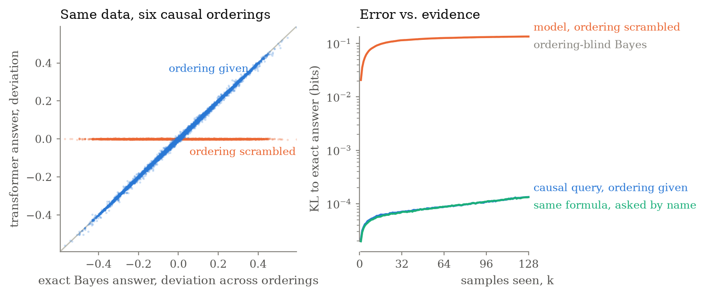
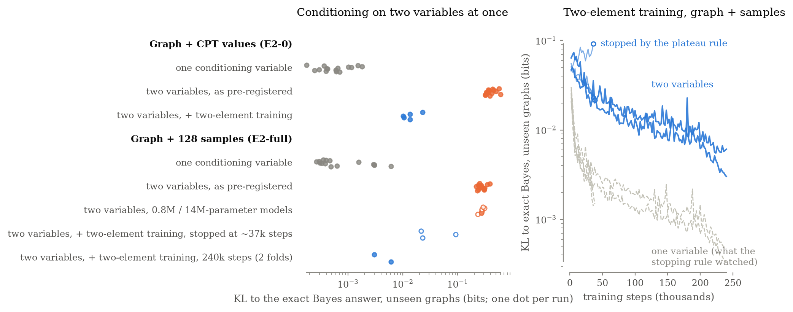
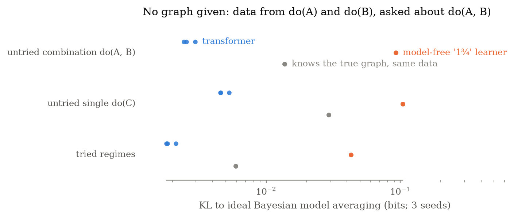
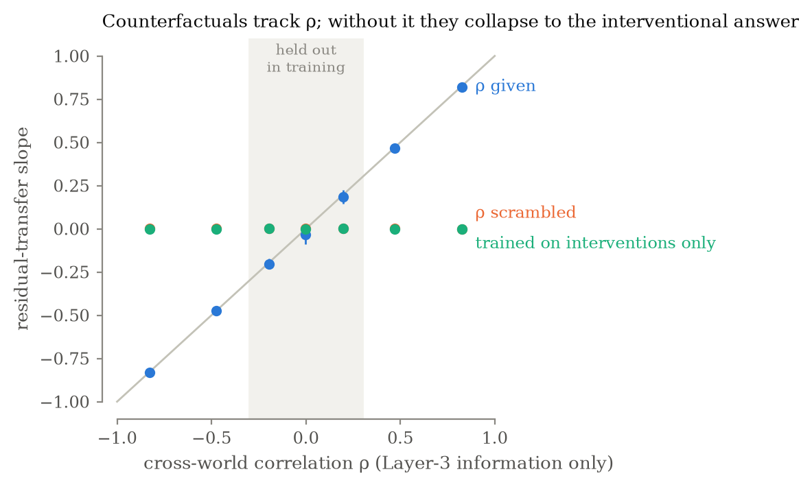
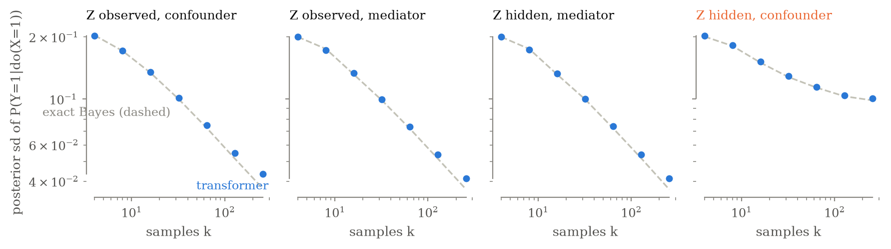

# Witnesses on the Ladder

*What the Causal Hierarchy Theorem does — and doesn't — say about transformers, tested in a wind tunnel.*

<!-- DRAFT for CP2. Numbers come from REPORT.md. ARM-3 PENDING marks the three E2-full re-runs still training (Addendum 4). -->

## Stuck on rung one?

Judea Pearl's ladder of causation has three rungs. On the first you *see*: you can estimate associations like $P(y \mid x)$ from data. On the second you *do*: you can say what happens to $Y$ if you reach in and set $X$, written $P(y \mid do(x))$. On the third you *imagine*: you can ask what *would have* happened to this particular case had things been different, $P(y_x \mid x', y')$.

A familiar argument says that large language models are stuck on the first rung. They learn from text, text is observational data, and the Causal Hierarchy Theorem (CHT) says observational data cannot answer interventional questions. Vishal Misra's "wall between Shannon and Kolmogorov" experiment was offered in the same spirit: a transformer trained on a modular recurrence predicts beautifully where it was trained and falls off a cliff where it wasn't, which he read as pattern-matching rather than a learned algorithm. When I followed up on that wall, it turned out to be a *calibration* barrier rather than a missing algorithm: give the network a single scalar hint about how uncertain to be, and the "missing" algorithm was there all along.[^wall]

Pearl himself put the reinforcement-learning version of the argument memorably in 2023. RL, he said, is "at level one and three-fourths. Reinforcement learning trains machines on interventions. … However, they cannot infer from this anything about a third move they haven't tried. They also cannot combine interventions to infer what will happen if they do both A and B." In the same interview he said something that gets quoted less often: "I have had to reconsider my proof that one cannot get any answer to any causal or counterfactual query from observational studies," because "text may contain information on levels two and three."[^pearl]

That second remark is the key to this post. The CHT is a theorem about **information**, not about **learners**.

## What the Causal Hierarchy Theorem actually says

The theorem (Bareinboim, Correa, Ibeling and Icard) says that for almost every structural causal model, the distributions on a lower rung leave the answers on the higher rung undetermined.[^cht] The proof device is a *witness pair*: two causal models that agree on everything at rung $k$ and disagree at rung $k+1$.

Here is the textbook pair at rung two. Take three binary variables and the same joint distribution $P(z, x, y)$. In one story $Z$ is a confounder ($Z \to X$, $Z \to Y$, $X \to Y$); in the other $Z$ is a mediator ($X \to Z \to Y$, $X \to Y$). Both graphs are complete, so both fit *any* joint distribution, and no amount of observational data can tell them apart. Yet the effect of intervening differs:

$$
P(y \mid do(x)) \;=\;
\begin{cases}
\sum_z P(y \mid x, z)\, P(z) & \text{if } Z \text{ is a confounder,}\\
P(y \mid x) & \text{if } Z \text{ is a mediator.}
\end{cases}
$$

When these two numbers have opposite signs you get Simpson's paradox, and the data alone cannot resolve it.

And here is a pair at rung three. Let $N$ be a fair coin and compare $Y := X \oplus N$ with $Y := N$. Under every intervention $Y$ is a fair coin in both models, so they are indistinguishable at rung two. But if we saw $X = 1, Y = 1$ and ask what $Y$ would have been had $X$ been $0$, the first model says $0$ and the second says $1$.

Any reasoner that uses only rung-$k$ information must give the *same* answer to both members of a witness pair. That is true of transformers, of people, and of do-calculus engines alike. So the theorem by itself cannot tell us that transformers are stuck: a transformer that fails to climb from rung one without extra information is merely illustrating the theorem, and so would any other learner. The interesting questions are different:

1. **Given** the information that distinguishes the pair, does the model compute the higher-rung answer?
2. Does it generalize that computation to structures and combinations it never saw?
3. And when the information is *not* given, does its uncertainty reflect that?

There is no complexity-theoretic reason to expect question 1 to be hard. An intervention is just "cut the arrows into $X$, then do ordinary inference", and a counterfactual is ordinary inference on a doubled copy of the model. Mossé, Ibeling and Icard proved that causal reasoning problems reduce to probabilistic ones with no jump in computational complexity.[^mii] How *much* information the higher rungs need can be large — Emadi recently quantified the gap in bits[^emadi] — but that is a statement about what must be supplied, not about who can use it.

## A wind tunnel for the ladder

Misra's other idea is the one I borrow: a "Bayesian wind tunnel", a synthetic task where the exact Bayes-optimal answer is computable, so a small transformer's predictions can be graded against ground truth to fractions of a bit.[^misra]

Every experiment below has the same shape:

- A **witness pair**: two causal models that agree one rung down and disagree on the rung being tested.
- The **distinguishing information** is given to the model as a token (a causal ordering, a graph, a mechanism parameter).
- An **exact oracle** computes the Bayes-optimal answer for each member of the pair.
- A **format-matched control** sees identical inputs with that token scrambled. By the theorem, its best possible answer is the same for both members.

Training is in the style of prior-fitted networks:[^pfn] each training episode's target is the *true* higher-rung quantity of that episode's causal model, so the loss is minimized exactly by the Bayes posterior under the training distribution. To be clear about what this does and does not test: the model is shown higher-rung targets during training. It is not learning causal effects from observational data — the CHT says nobody can. The question is whether, *given the bits*, it computes the right thing and generalizes it.

Everything was pre-registered before any GPU training: the hypotheses, the pass/fail thresholds, the held-out graphs, and the claims I would not make.[^prereg] Every run trains to convergence; runs that hit the step cap are labeled unconverged and never counted as negative evidence.

## Experiment 1: one bit buys the rung

Three binary variables, labels shuffled, a random joint distribution, and 128 samples. The query names a treatment and an outcome and asks for $P(Y = 1 \mid do(X = x))$ under one of the **six** complete causal orderings, given as a token. Depending on the ordering, the right answer is the adjusted formula, the crude conditional $P(y \mid x)$, or the marginal $P(y)$. The data carry no information about the ordering whatsoever.[^gh]

As a matched control on the arithmetic, half of the episodes instead ask for the *same formula by name*, with no causal language at all.

With the ordering token, the transformer's answers move across the six orderings exactly as the exact Bayes answers do. Regress the model's deviation across orderings on the oracle's and the slope is 1.000 ($R^2 = 0.999$). Measured as *gap closed* — how much of the distance between the ordering-blind Bayes answer and the exact answer the model covers — it is 0.999. Scramble the ordering token and the slope is 0.000: the control's answers don't move across orderings at all, because by construction nothing in its input can tell them apart. That is the theorem, visible in a scatter plot.

On episodes where Simpson's paradox bites, the model gets the sign of the effect right 99.5% of the time under the adjusted ordering and 100% under the crude one. And the causal question was no harder than the arithmetic: the error on "$P(Y = 1 \mid do(X = 1))$ under this ordering" is indistinguishable from the error on the same formula asked by name. All nine pre-registered criteria passed, as they should; E1 is a demonstration, and a failure here would have meant a bug.

## Experiment 2: Pearl's "one and three-fourths", with the graph supplied

Pearl's objection is about untried moves and combinations. Four binary variables; a random causal graph with in-degree at most two (25 shapes, 443 labeled graphs); labels shuffled every episode. The model is given the graph and either the conditional probability tables (E2-0) or 128 samples (E2-full), and is asked for $P(T = 1 \mid do(\cdot))$.

Every query is "untried" in Pearl's sense: the context contains no interventional data at all. Beyond that, three tests:

- **Unseen graphs.** Five-fold cross-validation over the 25 graph shapes; each fold's model never saw its five held-out shapes.
- **Combined interventions.** During training the second intervention slot is always empty or *inert* (it cannot affect the target). At test time both interventions matter, and conditioning gives a different answer from intervening.
- **Same data, swapped graph.** Two Markov-equivalent graphs fit the same data equally well but imply different interventions; does the model's answer move by the right amount?

As a matched control, the same model also answers *conditioning* questions on the same graphs.

**Given the graph and the probability tables (E2-0)**, everything Pearl named comes out clean. On the held-out shapes, in all five folds, interventional answers close 100.0% of the gap (to three decimals). Combined interventions — a query type the model never saw in training — also close 100.0%, on unseen graphs as well as familiar ones. And when two Markov-equivalent graphs are swapped on the same data, the answer moves by exactly the right amount (slope 1.000).

The surprise was the matched control. Asked to *condition* on two variables at once, $P(T = 1 \mid A = a, B = b)$, the same models close only 38–40% of the gap, and their answers sit about 0.4 bits from Bayes. Conditioning on one variable is fine. So the weak spot is not the causal rung: it is a composite *observational* query, also never seen in training.

**Given the graph and 128 samples instead (E2-full)**, the model must also estimate the probabilities. Single queries still transfer to unseen graphs: interventions close 98.5% of the gap, conditioning 91%, and the graph swap moves answers with slope 0.985. Now *both* composite queries fail: combined interventions close 11–22% of the gap, and two-variable conditioning stays about 0.28 bits from Bayes. By the pre-registered rules, a failure where the matched observational control also fails is not evidence for Pearl's "1¾" pattern; it says something else is wrong.

What is wrong is not capacity: models from 0.8 million to 14 million parameters fail the same way. It is not training length either. The composite error is flat from 20 thousand to 240 thousand training steps, while single-query error keeps falling.

It is the training distribution. After seeing these results I added one change, recorded before running it: replace a quarter of the training queries with queries whose two slots both matter. The evaluation sets are provably unchanged. With probability tables, two-variable conditioning on unseen graphs went from closing 40% of the gap to 98%. With samples, the two folds that trained for the full 240 thousand steps reached 0.003–0.006 bits on unseen graphs, down from 0.27, and combined interventions on familiar graphs went from about 0 to 91–93% of the gap. ARM-3 PENDING: three more folds were stopped early by a stopping rule that watched the wrong metric (it watched single-query error, which plateaus long before composite error does); they are being re-run to the full length, and two of them are the only folds whose unseen graphs admit a clean test of combined interventions with samples.

So the failure Pearl describes for reinforcement learners — "they cannot combine interventions" — did appear here, and it was not a rung-two barrier. It was a composite *query type* that had never been in training, observational or interventional alike. Once that type was in the training distribution, the two-element computation transferred to graphs the model had never seen.

## Experiment 2c: combining interventions without being given a model

This is the closest test of Pearl's actual claim. No graph is given. The context holds observational samples plus samples from two *tried* randomized experiments, $do(A)$ and $do(B)$ — exactly the experience of his chess-playing RL agent. The queries are the untried combination $do(A, B)$ and the untried single intervention $do(C)$. The reference is the ideal Bayesian learner with the same information: model averaging over all 443 graphs. The baseline is the best a model-free learner can do: answer tried moves from their frequencies, and untried ones from the nearest tried experiment or from observation.

The transformer closes 97.1% of the gap between the model-free learner and the ideal one on the untried combination, and 95.4% on the untried single intervention. On the tried regimes it is also closer to the ideal than the model-free learner is (0.002 vs 0.043 bits), because it pools evidence across regimes instead of answering each from its own frequencies. On the untried combination its answers sit about 0.003 bits from ideal Bayesian model averaging; the model-free learner sits at 0.09.

Where did the causal knowledge come from? From the training distribution: random graphs with in-degree at most two, a standard parameter prior, and the true interventional answers as targets. In Pearl's terms the network was given a *model class* rather than a model, and it learned to do inference within that class from the experiments in its context. That is not getting causal knowledge from data alone — the CHT rules that out for any learner — but it is the thing Pearl said a learner without a model can't do: answer for a move it hasn't tried, and for two moves combined.

## Experiment 3: counterfactuals and the residual twin

Rung three needs information that interventions cannot supply. Let

$$
Y = wX + \sigma\left[\mathbb{1}\{X > 0\}\, U_1 + \mathbb{1}\{X \le 0\}\left(\rho\, U_1 + \sqrt{1 - \rho^2}\, U_2\right)\right],
$$

with $U_1, U_2$ independent standard normal noise private to each unit. For every value of $\rho$ the noise is $N(0, \sigma^2)$ and independent of $X$, so all observational *and* interventional distributions are identical across $\rho$: it is pure rung-three information. For a unit observed at $(x^*, y^*)$, the counterfactual "had $X$ been $x'$" has expectation

$$
E[Y_{x'} \mid x^*, y^*] = w x' + r\,(y^* - w x^*), \qquad r = \begin{cases} 1 & \text{same side of } 0,\\ \rho & \text{crossing.} \end{cases}
$$

At $\rho = 1$ the unit's residual carries over; at $\rho = -1$ it flips; at $\rho = 0$ the counterfactual equals the interventional answer $w x'$. The model gets $\rho$ as a number (training never shows $|\rho| < 0.3$) and must estimate $w$ from the context. A control sees a scrambled $\rho$, and its Bayes-optimal counterfactual collapses *exactly* to the interventional answer.

The model's residual-transfer slope tracks $\rho$ to within 0.009 on average across the training range, and within 0.033 in the held-out band $|\rho| < 0.3$ it never saw. Same-side counterfactuals have slope 0.999. Both controls — $\rho$ scrambled, and a model trained only on interventional targets — produce a slope of essentially zero (at most 0.005) in every bin: without the rung-three information, the best counterfactual *is* the interventional answer, and that is what they give. The model's excess error over the Bayes error is 5.7%.

## Experiment 4: knowing what you can't know

The last demonstration turns the theorem itself into a measurement. With $Z$ observed, the effect of $X$ on $Y$ is identified and the exact posterior over it narrows like $1/\sqrt{N}$. With $Z$ hidden and confounding, it is not identified, and the posterior stops narrowing no matter how much data arrives. The control that makes this a clean test: with $Z$ hidden but acting as a *mediator*, the effect is identified again — using exactly the same input tokens.

In the three identified cells, the model's posterior width shrinks with a log-log slope of $-0.41$ to $-0.43$ (the exact posterior: $-0.48$). In the unidentified cell it nearly stops shrinking: slope $-0.12$, against $-0.13$ for the exact posterior. The hidden-mediator cell, with tokens identical to the hidden-confounder cell, shrinks like the observed cells. The model's uncertainty plateaus exactly where identification fails, and nowhere else.

Not everything passed. With $Z$ observed and confounding, the model's posterior is up to 22% wider than the exact one at the largest sample size, against a 15% tolerance. A follow-up with a finer output head made the excess larger, not smaller, which located it: the middle of the model's posterior matches the exact one (widths within a few percent), but its softmax output keeps a thin floor of probability in the far tails. The pre-registered coverage check failed too, in all four cells, but that one is a flaw of my own: it read interval ends off the output bins, which over-covers even for the exact posterior. With interval ends interpolated, the model's 80% intervals cover 79–82% of the time. Both failures stay on the record.

## Back in Misra's wind tunnel

Finally, the same witness pairs inside the task that started this: sequences from $x_{t+1} = a x_t + b \bmod 17$ with the program $(a, b)$ unknown.

At rung two, an intervention sets $x_t := v$ at a random position. Under *restart* semantics the sequence continues from $v$; under *clock* semantics it continues as if nothing had happened. The two produce identical observational sequences, so they differ only at rung two. Each model tracks its own semantics' exact answer: gap closed 0.992 (restart) and 0.998 (clock), measured against the other semantics' answer.

At rung three, each step adds a coin-flip of noise, and the question is what the next value would have been had $x_t$ been different. Reusing the noise inferred from what actually happened, or drawing it fresh, gives two models identical at rungs one and two. Both are tracked: gap closed 0.988–1.000.

Two pre-registered predictions failed. With the semantics flag zeroed out, the models do not fall back to the flag-blind answer (0.47–0.50 bits away, against 0.05). And on the 20% of programs held out of training, even ordinary next-value prediction fails: error about 170 times higher than on seen programs. That is what an exact Bayesian learner would do under a training prior that gives those programs zero probability, and the model's predictions match that learner closely. So there is no rung-three-specific failure to report there; there is a rung-one generalization failure, and my prediction that rung one would generalize was wrong.

## And Claude?

The small transformers say nothing about large language models, so I asked four Claude models directly. Each got 800 verbal versions of the witness pairs from E1, E3 and E4, generated by the same code, with nonsense variable names and randomized wording.

| | Opus 5.5 | Sonnet 5.5 | Haiku 4.5 | Fable 5.1 |
|---|---|---|---|---|
| Ordering stated: answers track the right formula (slope; ideal 1) | 1.01 | 1.00 | 0.78 | 1.02 |
| Ordering not stated: says the effect can't be determined | 100% | 100% | 47% | 100% |
| ρ stated: counterfactual tracks ρ (slope; ideal 1) | 1.00 | 0.90 | 1.00 | 0.95 |
| ρ not stated: gives the interventional answer for crossing queries | yes | yes | yes | yes |
| Confounder unmeasured: says "not identifiable" | 100% | 100% | 100% | 100% |
| … and gives the correct bounds | 100% | 100% | 3% | 100% |

Opus, Sonnet and Fable computed the higher-rung answer when given the distinguishing information, and declined to when it was missing; Haiku often did not. These are verbal answers to stated textbook problems. They show what the models *say*, not how they represent anything.

## What this does and doesn't show

**What it shows.** Where the distinguishing information was supplied, small transformers computed higher-rung answers within thousandths of a bit of exact Bayes, on graphs and values of $\rho$ they had never seen. The exception is E5's unseen programs, where even rung one failed. When the information was withheld, their answers collapsed to exactly what the theorem says is the best possible, and in E4 their uncertainty stopped shrinking where identification fails. The largest failure — composite queries — turned out to be a gap in the training distribution. Closing it transferred to unseen graphs: fully with probability tables, and so far in the two finished folds with samples.

**What it doesn't show.** Nothing here refutes Pearl or the Causal Hierarchy Theorem. Every experiment *relies* on the theorem, and giving the model a graph is Pearl's own recipe. Nothing was learned from observational data alone: training targets were the true higher-rung quantities. The models are tiny (under 15 million parameters), the worlds are small (at most four binary variables), and "interventions" means the truncated factorization, nothing more of the do-calculus. None of it is evidence about how large language models work; E6 is a separate, behavioral question.

**What would change my mind.** If composite queries still failed on unseen graphs *after* being included in training, at full training length, that would point to something harder than a training-distribution gap. The three re-runs still in progress are the cleanest remaining test of that with samples. ARM-3 PENDING.

The theorem is about information. Given the information, these networks used it.

*Code, configs, pre-registration and every number in this post: [github.com/riemannzeta/ladder-witnesses](https://github.com/riemannzeta/ladder-witnesses).*

<!-- Optional: "This work was carried out with substantial help from Claude (Anthropic), which wrote much of the code and an early draft of this post." Keep or cut. -->

[^wall]: See my earlier wall-erosion experiments: [github.com/riemannzeta/wall-erosion-experiment](https://github.com/riemannzeta/wall-erosion-experiment).

[^pearl]: Interview with Dana Mackenzie, *Amstat News*, September 2023.

[^cht]: E. Bareinboim, J. Correa, D. Ibeling and T. Icard, "On Pearl's Hierarchy and the Foundations of Causal Inference" (2022). See also K. Xia, K.-Z. Lee, Y. Bengio and E. Bareinboim, "The Causal-Neural Connection" (NeurIPS 2021), which shows that the theorem holds for neural causal models however expressive they are.

[^mii]: M. Mossé, D. Ibeling and T. Icard, "Is Causal Reasoning Harder Than Probabilistic Reasoning?", *Review of Symbolic Logic* 17 (2024). Their result concerns the satisfiability of causal versus probabilistic logics.

[^emadi]: S. M. Emadi, "The Causal Description Gap: Information-Theoretic Separations Across Pearl's Hierarchy" (2026).

[^misra]: N. Agarwal, S. R. Dalal and V. Misra, "The Bayesian Geometry of Transformer Attention" (2025).

[^pfn]: S. Müller et al., "Transformers Can Do Bayesian Inference" (ICLR 2022). Related causal versions: Do-PFN (Robertson et al., NeurIPS 2025) and in-context counterfactual reasoning (Miller, Schölkopf and Guo, NeurIPS 2025).

[^prereg]: `PREDICTIONS.md` in the repository, committed before any GPU run.

[^gh]: Under a Dirichlet prior on the joint distribution, every complete ordering factorizes into independent conditional priors (Geiger and Heckerman 1997), so the ordering is exactly uninformative about the data.
